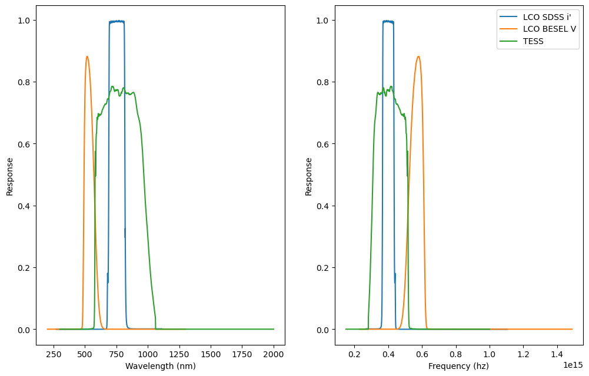
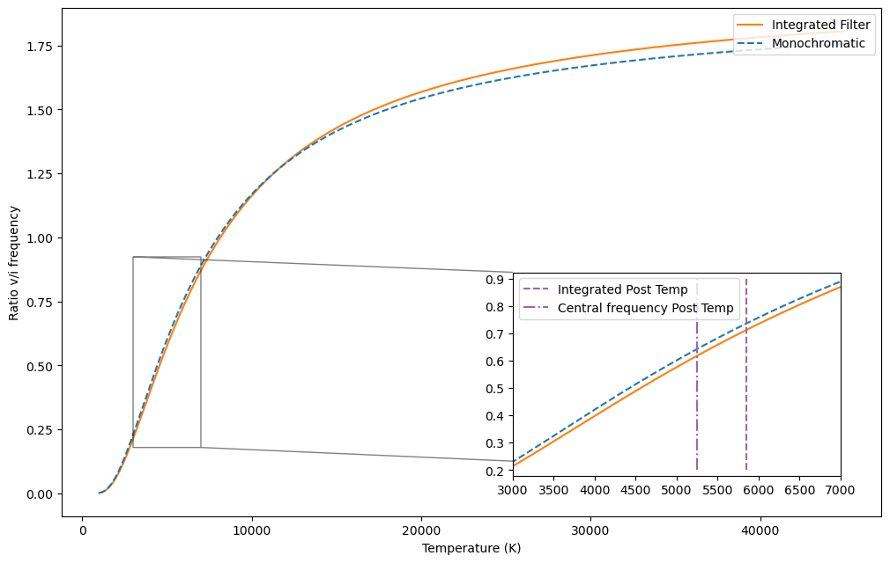
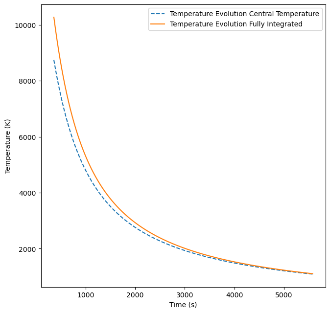

# Flare Energetics on J0508-21

This repository estimates the temperature, emitting area, peak luminosity, and
bolometric energy of the fast optical flare using LCO $V$ and $i'$
photometry observed on J0508-21. We compare two ways to model the passbands:

1. **Central-wavelength approximation:** represent each filter by its central
   frequency.
2. **Response-integrated calculation:** fold a blackbody spectrum through
   each measured filter response and integrate numerically.

## Contributors
- Daniele Vigano 
- Simranpreet Kaur
- Aaron Maas

## Model and methods

The flare spectrum is approximated as a blackbody. Its spectral radiance is

$$
B_\nu(T) = \frac{2 h \nu^3}{c^2}
           \left(\frac{1}{\exp\left(\frac{h\nu}{k_{\rm B}T}\right)-1}\right).
$$

The observed $V/i'$ flux-density ratio at the post-peak observation is
matched to the blackbody color to estimate the post-peak temperature for which we have simultaneous observation. The
central-wavelength method evaluates $B_\nu$ at each filter's central
frequency:

$$
\frac{F_{\nu,V}}{F_{\nu,i'}} \simeq
\frac{B_{\nu_V}(T)}{B_{\nu_{i'}}(T)}.
$$

The integrated method instead computes a response-weighted mean over each
filter,

$$
\langle B_\nu(T)\rangle_b =
\frac{\int B_\nu(T) S_b(\nu)\,d\nu}{\int S_b(\nu)\,d\nu},
\qquad
\frac{F_{\nu,V}}{F_{\nu,i'}} \simeq
\frac{\langle B_\nu(T)\rangle_V}{\langle B_\nu(T)\rangle_{i'}},
$$

where $S_b(\nu)$ is the filter response. We used the trapezoidal
rule for these integrals and a numerical root finder to infer temperature in
the time-dependent integrated calculation.

For either method, the notebook converts the measured flux density to
specific luminosity using

$$
L_\nu = 4\pi d^2 F_\nu,
$$

then infers an emitting area from the blackbody brightness. Bolometric
luminosity and energy are estimated as

$$
L_{\rm bol}(t)=\sigma_{\rm SB} A T(t)^4,
\qquad
E_{\rm bol} \simeq \sum_j L_{\rm bol}(t_j)\,\Delta t.
$$

We also explored a constant-temperature approximation, for which
we estimate the total energy as

$$
E_{\rm bol} \simeq L_{\rm peak}
(\tau_{\rm rise}+\tau_{\rm decay}),
$$

, with $tau$ being the rise or decay time scale (this formula can be obtained by assuming constant temperature and integrating our double exponential
model fully. 
As comparison we also calculated constant-area scenario in which the temperature is solved as the flare
fades.

## Findings 

The values below are reported by the jupyter notebook. The main comparison uses the
constant-area, evolving-temperature scenario:

| Method | Post-peak temperature | Peak temperature | Bolometric energy |
|---|---|---|---|
| Central wavelengths | $5250\ \mathrm{K}$ | $8741\ \mathrm{K}$ | $2.21\times10^{35}\ \mathrm{erg}$ |
| Filter integrated | $5850\ \mathrm{K}$ | $10268\ \mathrm{K}$ | $3.73\times10^{35}\ \mathrm{erg}$ |

In the central-wavelength calculation, the post-peak emitting-radius estimate
is $0.197\,R_\odot$ (about $0.44$ times the adopted stellar radius). The
integrated calculation reports a post-peak area of
$1.62\times10^{17}\,\mathrm{m}^2$. These are model-dependent estimates; the
temperature and energy depend on the assumed blackbody spectrum,
emitting-area evolution, flare decay, and filter treatment.

## Flare timing

The double-exponential flare model uses a rise timescale of
$\tau_{\rm rise}=18\ \mathrm{s}$ and a decay timescale of
$\tau_{\rm decay}=361.2\ \mathrm{s}$ (about $6.02$ minutes) (from fit to i' band data). The modeled
$i'$-band peak is $17\ \mathrm{s}$ after the reference time. The $V$-band
post-flare observation is about $9.29$ minutes after that modeled peak.

## Figures

The following figures are saved outputs from the notebook:

**LCO and TESS filter responses**

**Color-temperature relation:** response-integrated and central-frequency
ratios give similar, but not identical, post-peak temperatures.

**Temperature evolution:** saved model curves for the central-wavelength and
response-integrated calculations.

